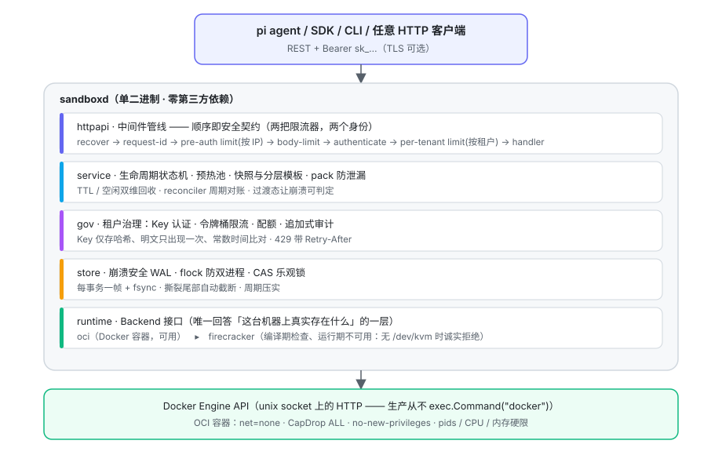
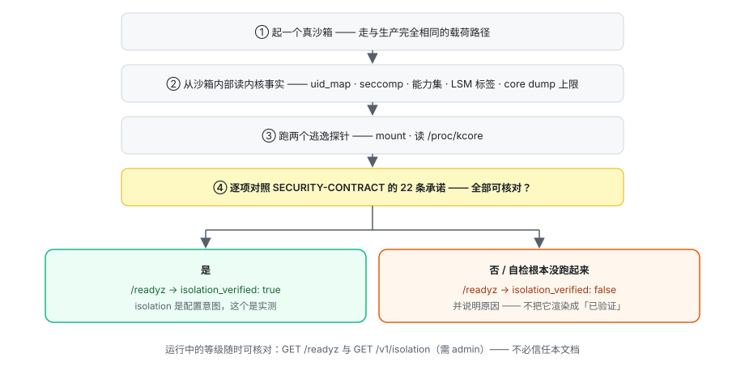

<div align="center">

# Sandcastle（沙堡）

**为 AI Agent 而建、用完即弃的隔离执行城堡。**

*A single-binary, multi-tenant sandbox runtime for AI agents — stdlib-only Go.*

秒级创建 · 暂停 / 恢复 / 快照 · 预热池 · 配额限流 · 全链路审计 · 崩溃安全

</div>

---

## 一、它是什么

AI Agent 的本质，是一个**自己会敲命令的程序**。让它直接在你的服务器上执行，等于把客厅交给一位会放火的客人：

- 它可能删错文件、装来路不明的依赖、被**提示注入**后把数据外传（2026-01 已出现首个针对 agentic AI 系统的 CVE）；
- 它的失败不只是"崩溃退出"——失控循环吃光内存、fork 炸弹、把 `/proc` 读到内核崩溃；
- 多团队 / 多客户共用基础设施时，"谁在用、用了多少、干了什么"必须可管、可查、可计费。

Sandcastle 把 agent 的每一条命令，从"在你家客厅放火"变成"在**一个用完即扔的防爆间**里放火"：
防爆间按人头计费（租户 / 配额 / 限流）、有监控录像（不可变审计）、烧了也不心疼（TTL 自毁 + 快照恢复）。

适用场景：企业自托管的 Agent 平台执行底座（编码 Agent、办公 Agent、RL / 评测环境）、
Agent 多租户 SaaS 的隔离层、可信或半可信租户之间的隔离边界。

> **差异化不在"隔离更强"，而在"边界更可核对"**：运行中的隔离等级是机器可读、随时可自己核对的，
> 不承诺的能力被明确写进契约——而不是藏在文档的语气里。完整论证见
> [`docs/POSITIONING.md`](docs/POSITIONING.md)。

## 二、架构：一次请求穿过的五层



自顶向下，每一层只回答一个问题——这就是全部的分层理由：

| 层 | 唯一职责 |
|---|---|
| `httpapi` | 认证了谁、限没限住、记没记账 |
| `service` | 状态机与编排——**唯一有权改状态的地方** |
| `gov` | 租户治理：Key、限流、配额、审计 |
| `store` | 崩溃安全的落盘 |
| `runtime` | **这台机器上真实存在什么**（`oci` 可用 / `firecracker` 骨架） |

依赖方向严格单向，因此未来加节点、换后端都不动业务逻辑。有一条细节值得单独指出：
**中间件的顺序本身就是安全契约**，而且它不是"一把限流器放在哪"的问题——

```
accessLog → recover → request-id → pre-auth limit（按客户端 IP）
         → body-limit → authenticate → per-tenant limit（按租户）→ handler
```

**两把限流器、两个身份。** v1.1.0 只有一把，且放在 `authenticate` 内侧（"限流需要租户身份"）。
这句话对**业务配额**成立，代价却是：认证失败的请求根本不经过限流，却仍然各写一条审计
（即一次 fsync）——400 个未认证请求产生 400 次 fsync、0 个 429，一个不需要任何凭据的
**I/O 放大器**。修法不是把限流器搬出去，而是拆成两把：外层按 IP 做粗粒度防洪闸，
内层按租户做权威业务配额。

### 一次创建的完整旅程

```
CLI ──▶ 中间件链（认证 → 限流）──▶ 治理准入（模板解析 · 规格校验 · egress 检查 · 配额）
    ──▶ 意图落盘（provisioning，WAL + fsync）        ← 从此任何时刻断电都可判定
    ──▶ 预热池命中？── 是 ──▶ 直接采用（毫秒级，状态 = running）
                   └── 否 ──▶ 异步供给：OCI Create → Start → 轮询确认真实相位
    ──▶ waitForState 轮询 store ──▶ 201 返回
此后：TTL / 空闲清扫器回收僵尸 · reconciler 周期对账 · 每一步动作入审计流
```

### 沙箱状态机

```
provisioning ─▶ running ⇄ pausing/paused ⇄ resuming ─▶ stopping ─▶ stopped（终态）
      └─▶ failed ─▶ stopping                任意存活态 ─▶ stopping
```

客户端只能走合法边；reconciler 直接写"真相"。四个过渡态的存在，让**崩溃成为可判定的事件，
而不是需要人工猜测的重试**。

## 三、六条设计判断

**1. 崩溃必须可判定，而不是可重试。**
沙箱是长命有状态对象，守护进程却随时可能被 `kill -9`。Sandcastle 采用**意图先行持久化**：
create 先把 `provisioning` 意图写进 WAL，再触碰后端；凡处于过渡态的记录，重启后一律视为
"被打断的操作"，由 reconciler 向后端重新探测真相并收敛。本地状态只是假设，后端才是事实。
（灾备测试：连续三次 `kill -9`，状态零漂移。）

**2. 控制面与数据面分离。** 吸收自 E2B 的分层，本地化为单二进制内的模块边界。

**3. 诚实语义：拒绝，而不是假装。**
后端无法真实强制的能力，**拒绝创建而不是静默降级**：容器后端做不了内核级出口白名单，
`egress.mode=allowlist` 的创建直接返回 **501**；overlayfs 上强制不了单沙箱磁盘配额，
请求 `disk_mib` 同样被拒。一个"看起来受限、实际没有"的沙箱比没有更危险——
这条原则有专门的 honest-refusal 测试锁死。

**4. 治理是一等公民，不是插件。** 多租户、API Key（仅存哈希、常数时间比对、明文只出现一次）、
租户级配额、按租户 × 操作组的令牌桶限流、不可变审计流——与沙箱生命周期**同级设计**，
而非事后补挂。

**5. 快照即创建。** 冷启动只发生在池未命中时。按模板预热**从未执行过任何工作负载**的纯净容器
（纯净 = 交给任何租户都不泄漏），命中即毫秒级交付；暂停 / 快照 / 模板三种产物对齐形状，
恢复共用同一条快路径。

**6. 零第三方依赖（stdlib-only Go）。** 供应链攻击面为零、无依赖冲突、单文件分发、可气隙构建。
代价是 WAL 存储、Prometheus 指标、令牌桶、Docker API 客户端全部手写——
而这让**每一行都在 review 范围内**。

## 四、隔离档位：可核对，不声称

> ### ⚠️ 当前是**容器**档，不是 microVM
>
> 本版实际可用的后端只有 **OCI 容器**（`container-shared-kernel`）。沙箱与宿主**共享内核**：
> 命名空间、能力裁剪、零网络、pids / 内存 / CPU 硬限都真实生效，但**一个内核提权漏洞
> 就是一次沙箱逃逸**。
>
> 因此本版适合**可信或半可信**租户之间的隔离，**不适合**运行"明知有恶意、且会主动攻击内核"的
> 任意代码。需要 microVM 那档隔离时设 `isolation = microvm`——守护进程会在启动时**直接拒绝**，
> 而不是悄悄退回容器跑。这是刻意的：一个"以为在跑 microVM"的部署，比明说"只有容器"更危险。

运行中的等级**机器可读**，随时可核对，不必信任本文档：

```bash
curl -s http://127.0.0.1:8080/readyz
# {"backend":"oci","isolation":"container-shared-kernel",
#  "isolation_verified":true,"isolation_userns":"off",
#  "isolation_note":"... NOT for running arbitrary untrusted code","status":"ready"}
```

`isolation` 是**配置意图**，`isolation_verified` 是**实测**。守护进程启动时会走一遍下面的闭环：



关键在最后一步：**自检没跑起来时它报 `false` 并说明原因，绝不把"未验证"渲染成"已验证"**。
这在容器档尤其重要——容器引擎会接受它无法兑现的安全设置并原样回显，所以只有从
**运行中的沙箱内部**读到的 `/proc/self/*` 才算证据。完整证据与"明确不承诺"清单一节见
[`docs/SECURITY-CONTRACT.md`](docs/SECURITY-CONTRACT.md)。

## 五、能力全景

| 域 | 能力 |
|---|---|
| **隔离** | net=none（默认零网络）· CapDrop ALL · no-new-privileges · pids-limit · 禁 swap 内存硬限（OOM 显式可见，exit 137）· CPU 配额；microVM 后端骨架（无 `/dev/kvm` 时诚实拒绝） |
| **生命周期** | 同步创建（等待就绪 / 立即返回）· 暂停与**透明恢复**（对 paused 的请求自动先恢复）· 停止 / 强杀 · 暂停期主动内存回收 · 硬 TTL 与空闲超时**双维**回收 |
| **执行与文件** | 同步 exec（argv / shell、超时硬截止、输出截断、退出码透传、**幂等键**）· 文件上传 / 下载 / 列举 / 删除（路径三重校验防穿越）· 只读挂载（operator 白名单、默认关闭） |
| **快照与环境** | 快照 → 重建 · **pack 防泄漏打包**（提交前清除构建残留）· **分层模板组合**（base + toolkit 独立版本化）· 离线 rootfs 导入（气隙部署） |
| **治理与计量** | 租户 / Key / 即时吊销 · 配额（并发 / CPU / 内存 / 快照）· 按组限流 · 追加式审计（可按租户 / 沙箱 / 动作过滤）· 资源秒计量（CPU 与内存分开、**暂停仍计内存**） |
| **运维** | `/healthz` `/readyz` `/metrics`（Prometheus 文本）· 结构化 JSON 日志（`request_id` 贯穿）· 优雅停机 · WAL 自动压实 · 一致性备份 |

**Agent 集成**：[pi coding agent 官方扩展](integrations/pi/pi-sbx/README.md)——pi 与 LLM 凭据留在宿主机，
bash 工具经 REST 路由进沙箱；已用 **Z.ai GLM-5.3-flash** 完成真实端到端验证：
GLM 驱动 pi 在沙箱内写文件，宿主机确认该文件不存在——隔离边界成立。

## 六、质量与证据

### 一套端到端套件，一个共用 harness

全部端到端断言是一个 Go 测试包（`tests/`），共用 harness：daemon 生命周期、带类型客户端、
租户与沙箱夹具。harness **直接复用生产侧的 `internal/domain` 类型**，所以字段改名是
**编译错误**而不是静默漏测。另有 9 个内部包的单测 / 集成测试，`-race` 全绿。

**一条准入规则**：`SBX_REQUIRE_DOCKER=1` 会把"没有容器运行时"从**静默跳过**变成**失败**——
一个静默跳过的套件，和一个通过的套件，在报告上长得一模一样。

| 套件 | 覆盖 | 结果 |
|---|---|---|
| 隔离契约 | 22 项，全部从**运行中沙箱内部**读内核事实（seccomp / NoNewPrivs / 能力集 / uid_map / ulimit / 设备 / 套接字 / 路由），并断言 daemon 自检与本套件结论一致 | 22/22 |
| 遏制 | `rm -rf /` 爆炸半径、fork 炸弹、内存炸弹、CPU 独占、沙箱内写宿主路径（每项都带**正向对照**） | 5/5 |
| 治理与生命周期 | 配额上限与释放、限流、12 类非法 spec、env 洪水、透明恢复（含 `auto_resume=false` 反向姿态）、停止终态、非法转换、TTL 延长、创建失败上报 | 8 子场景 |
| 文件与快照 | 字节级往返、路径拒绝、目录缺失 404、目录列举、超限上传、快照被新沙箱继承 | 6/6 |
| API 契约 | 401/403/404/405/400 全谱、请求 ID 回显、错误包络完整性、跨租户 403 五资源、admin 边界、密钥永不可读 | 19 子场景 + 2 独立套件 |
| 并发 | 并发创建归属、20 路并发 exec 输出不串、租户间文件系统不共享、并发删除与读取、配额在并发下的真实语义 | 4/4 |
| 混沌与灾难 | 在途创建遇 `kill -9`、存活沙箱穿越崩溃、连续三次崩溃的 WAL 完整性、优雅重启、备份时点恢复 | 全通过 |
| 计量与幂等 | 资源秒随 exec 即时反映、按租户隔离、admin 视角、幂等键重放 / 单飞 / 参数冲突 | 全通过 |
| 泄漏检测 | 删除后无残留容器、无残留快照镜像、孤儿快照镜像回收 | 全通过 |
| 后端不可达 | 容器运行时被切断时的降级与恢复（会打断本机其他工作负载） | 默认 SKIP，`make test-e2e-destructive` |

一键复跑：`make test-e2e`（含 pi 扩展的真实 bash 工具契约驱动）。

### 关键实测数字（测试日志原话，非估计）

```
内存炸弹（64 MiB 上限）        → exit=137（SIGKILL）；邻居沙箱继续正常 exec
CPU 独占期间控制面              → 5 次健康检查 1 ms，无关沙箱 exec 36 ms
fork 炸弹                       → timed_out=true，daemon 全程可响应，沙箱仍可回收
20 路并发创建对租户上限 5       → 20 全部放行（越限 15），下一次创建被 402 拒绝
沙箱内写 /etc/hosts、/etc/passwd → 沙箱内写入成功，宿主同名文件摘要不变
孤儿快照镜像                    → 回收前 89 个，回收后 0 个
```

### 商用五维验收（`make test-commercial`，约 4 分钟）

买方的技术评审不会问"你有多少测试"，而是分开问五个轴。每个轴一个端到端场景，
**断言比值与形状，而不是绝对毫秒**——绝对数字是机器的属性，一个在忙机器上会失败的套件
最终会被静音，而被静音的套件保护不了任何东西。

| 轴 | 断言的东西 | 实测 |
|---|---|---|
| **启动实效** | ready 之前必须真的能干活 | 冷启动到 `/readyz` 200 随机器冷热在 **0.7 – 7.7 s**（被容器引擎与隔离自检主导，两者都 I/O 密集）；ready 后首个建沙箱请求 **188 ms**；带 9 个存活沙箱重启 **166 ms** 且 9 个全部仍 `running` |
| **高并发** | 饱和时的答案**可治理**，账目精确 | 80 个同时建沙箱（限速 10/s burst 10）→ **201×10 / 429×70**，全部带 `Retry-After`，**记录数 = 10、容器数 = 基线 + 10**（零幽灵记录） |
| **可用性** | 负载**进行中**持续可用且不漂移 | 12 秒 2,968 次请求全 200（0 个 5xx / 429 / 无响应）；`/readyz` 采样 **47/47**；p50 前半 41.0 ms → 后半 41.4 ms（×1.01） |
| **弹性** | 回收是**真的**回收，不是改标签 | 空闲预算 60 s → **1 分 6 秒**回收，同期被使用的 twin 存活；TTL 35 s → **36 秒**回收，且**配额真的被归还**（随后新建成功） |
| **响应性** | 控制面开销有界，且**不随规模增长** | 地板 `/healthz` p50 **73 µs**、401 **96 µs**、读 **81 µs**、exec **26.9 ms**（其中控制面自身约 **10 µs**）；fleet 1→12：读 p50 ×0.9、exec p50 ×1.1 |
| **多租户噪声** | 邻居过载不消耗你的预算，也不变成你的延迟 | 安静租户 p50 79 µs → 风暴中 229 µs → 风暴后 85 µs，**风暴期间零拒绝**；吵闹租户 200×8 / 429×4，零 5xx |

安全不在这份套件里，因为它已有三个专属套件；复述一遍只会得到一个"绿但不新"的测试。
可复跑的冷启动 / 吞吐报告另见 `make bench` → [`docs/bench-summary.json`](docs/bench-summary.json)。

### 这些套件抓出并修复的缺陷

1. **畸形 ID 返回 500 且标记为可重试**——一次拼写错误生成重试风暴，还被报成服务端错误；
2. **运维在配置里提供的 bootstrap admin key 仍被打印到 stdout / journal**；
3. **孤儿快照镜像无限增长**——`docker image prune` 不会删带标签的镜像，而代码注释却声称有 GC
   在管（实测本机积压 89 个）；
4. **`spec.idle_timeout_seconds` 被 `mergeSpec` 静默丢弃**——校验通过、返回 201、文档宣称可用，
   但永远取平台默认值，逐沙箱空闲回收在修复前**不可达**。修复后该场景成为回归测试，
   断言的是**回收真的发生了**，而不是"响应里有那个字段"。

完整复盘见 [`CHANGELOG.md`](CHANGELOG.md) 与 [`SECURITY-CONTRACT.md` §7](docs/SECURITY-CONTRACT.md)。
（这里不写"累计修复 N 个"——那个整数无法从历史记录里客观重建，而一个重建不出来的数字，
不该出现在给客户看的文档里。）

## 七、定位：与同类项目的关系

| | Sandcastle | E2B | Daytona | DSec（DeepSeek） |
|---|---|---|---|---|
| 形态 | **单二进制，自托管** | 云服务 + 大型开源 runtime | **2026-06 闭源、2026-10-03 仓库归档** | 生产训练平台，未开源 |
| 依赖 | 零第三方（stdlib-only） | Go + 全家桶（Consul / Nomad / …） | — | 3FS / EROFS / 自研调度 |
| 多租户治理 | 内建（Key / 配额 / 限流 / 审计） | 内建 | 内建 | 内建 |
| 适用 | 读得懂全部代码的**自托管执行底座** | 云端 / 企业专用部署 | 控制面在厂商侧（BYOC） | RL 训练基础设施 |

Daytona 是与本项目**架构最接近**的同类：同样默认容器档隔离、把 Kata / Sysbox 作为可选强化。
但它在 2026-06 把核心开发移入私有仓库、2026-10-03 归档了公开仓库，自托管文档也从官网移除。
官方理由是"AI 辅助的漏洞挖掘正针对公开的隔离代码"。这句话本身就是容器档定位的注脚：
**一个架构选择与本项目重合的公司，因为同一档隔离的实现细节经不起公开，而选择了关灯。**
本项目的回答不是把实现藏起来，而是把**契约**公开——哪些是实测的、哪些明确不承诺、怎么自己核对。

Sandcastle 不试图复刻 DSec 的 16 万核调度；它把其中**在单机同样成立的设计**
（透明恢复、暂停内存回收、空闲超时、分层环境、pack 防泄漏）带给自托管场景，
其余部分（eBPF 网络白名单、EROFS 按需镜像等）写成明确的路线图。

卖出 / 不卖给谁、威胁模型边界、胜负清单见 [`docs/POSITIONING.md`](docs/POSITIONING.md)——
它由一次**可复跑**的端到端演练支撑：

```bash
make scenario-flow     # 跑演练 → 生成 docs/scenario-flow.html（由调用轨迹渲染的动态流程图）
```

演练覆盖「多业务线 AI 编程助手」的完整链路：平台接入与合规取证 → 建沙箱 / 传代码 / 执行 /
取产物 → 快照复用 → 暂停回收与透明恢复 → 治理边界 → 审计与回收 → 崩溃恢复。流程图
**由调用轨迹渲染**，并单独标注本版未实现、不可强制与已知缺口的能力——
**改流程必须重跑演练，而不是改那张图**。

## 八、快速开始

要求：任何能跑 Docker 的环境（Linux 生产 / macOS + colima 或 Docker Desktop 开发）。

```bash
git clone https://github.com/Hongli-xd/castle.git && cd castle
make build                                    # bin/sandboxd + bin/sbxctl

cat > sandboxd.conf <<'EOF'
listen  = "127.0.0.1:8080"
data_dir = "./data"
bootstrap.image = "alpine:3.22"               # 本机已有该镜像则自动播种默认模板
EOF
./bin/sandboxd -config sandboxd.conf
# 首次启动打印一次 ADMIN API KEY —— 立即保存

export SBX_URL=http://127.0.0.1:8080
export SBX_API_KEY=<管理员Key>
./bin/sbxctl tenant-create demo quota.max_sandboxes=10
./bin/sbxctl key-create <tnt_id> demo-key     # 租户 Key 明文仅此一次
```

日常使用：

```bash
export SBX_API_KEY=<租户Key>
./bin/sbxctl create --template default        # {"id":"sbx_...","state":"running"}
./bin/sbxctl sh <sbx_id> -- "echo hello && uname -m"
./bin/sbxctl cp <sbx_id> ./data.csv /root/
./bin/sbxctl snapshot-create <sbx_id> checkpoint-1
./bin/sbxctl create --snapshot <snp_id>       # 从快照恢复新沙箱
```

## 九、API 一览（REST，统一错误包络）

```
POST   /v1/sandboxes?wait=true|false   创建（template_id | snapshot_id | base_image 三选一）
GET    /v1/sandboxes                   列表（state 过滤）
POST   /v1/sandboxes/{id}/pause|resume|stop|timeout
DELETE /v1/sandboxes/{id}
POST   /v1/sandboxes/{id}/exec         {command | argv, timeout_ms, max_output, idempotency_key}
PUT/GET/DELETE /v1/sandboxes/{id}/files?path=        GET …/files/list
POST   /v1/snapshots                   {sandbox_id, name, pack:{cleanup:[...]}}
GET    /v1/templates                   POST /v1/templates/compose|import   (admin)
GET    /v1/events                      审计事件流（租户自动限定）
GET    /v1/metering                    资源秒计量（租户自动限定）
POST   /v1/tenants …/keys              租户与 Key 管理 (admin)
GET    /v1/isolation                   本机隔离自检清单 (admin)
GET    /healthz /readyz /metrics       （/metrics 需 admin——运维数据不该对所有人开放）
```

错误以**稳定的 code** 分支（`quota_exceeded` / `rate_limited` / `unimplemented` / …），
HTTP 状态码不参与重试判定。完整语义见 [`docs/API.md`](docs/API.md)。

## 十、文档地图

| 文档 | 内容 |
|---|---|
| [`docs/LEARNING-GUIDE.md`](docs/LEARNING-GUIDE.md) | **从零基础到能应对技术面**：Go 与 Shell（只讲本项目用到的）、容器与隔离、持久化与崩溃恢复、治理、HTTP 契约、测试方法论、运维，含 68 道面试题 |
| [`docs/SECURITY-CONTRACT.md`](docs/SECURITY-CONTRACT.md) | **对客户的可核对承诺**：逐层隔离证据、遏制实测数字、明确不承诺的边界、自己怎么验 |
| [`docs/POSITIONING.md`](docs/POSITIONING.md) | 卖给谁 / 不卖给谁、威胁模型边界、与 Docker 的分界、竞争格局 |
| [`docs/DESIGN.md`](docs/DESIGN.md) | 领域模型、状态机、可靠性设计、DSec 吸收路线图 |
| [`docs/ROADMAP.md`](docs/ROADMAP.md) | 已交付项的验收标准、P1 / P2 方向，以及"刻意不做"清单（Harness / 模型路由 / eval / GPU） |
| [`docs/THREAT-MODEL.md`](docs/THREAT-MODEL.md) | 威胁主体、容器 / microVM 隔离分级、诚实拒绝清单、验证矩阵 |
| [`docs/DEPLOYMENT.md`](docs/DEPLOYMENT.md) | 生产部署、气隙安装、备份恢复、运行手册 |
| [`docs/RESEARCH.md`](docs/RESEARCH.md) | 赛道调研（E2B / Daytona 闭源 / DSec / pi）与决策依据 |
| [`docs/API.md`](docs/API.md) | 完整 API 参考 |
| [`docs/scenario-flow.html`](docs/scenario-flow.html) | **由调用轨迹渲染**的企业场景流程图（未实现 / 不可强制 / 已知缺口分三带标注） |
| [`CHANGELOG.md`](CHANGELOG.md) | 版本历史（含测试抓出的缺陷复盘） |

## 十一、路线图

本版本的隔离档位**明确是容器级（共享内核）**，microVM 不在本版本内。这是定价与选型的前提，
不是待办事项——见 [`docs/SECURITY-CONTRACT.md`](docs/SECURITY-CONTRACT.md)。

- **中期**：eBPF 按沙箱网络白名单（容器后端 egress 从诚实拒绝升级为内核级强制）· AppArmor
  文件 / 套接字加固 · exec 流式输出与 PTY · 平台级速率默认值可配置
- **远期**：Firecracker microVM 后端（接口已锁定，需 `/dev/kvm`）· EROFS + 分布式 FS 按需镜像 ·
  多节点放置（power-of-k）· Postgres 存储后端 · 事件 Webhook

## 许可证

Apache-2.0。欢迎 issue / PR。
